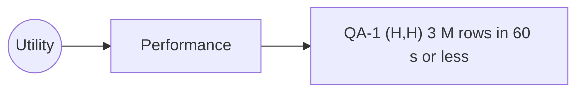
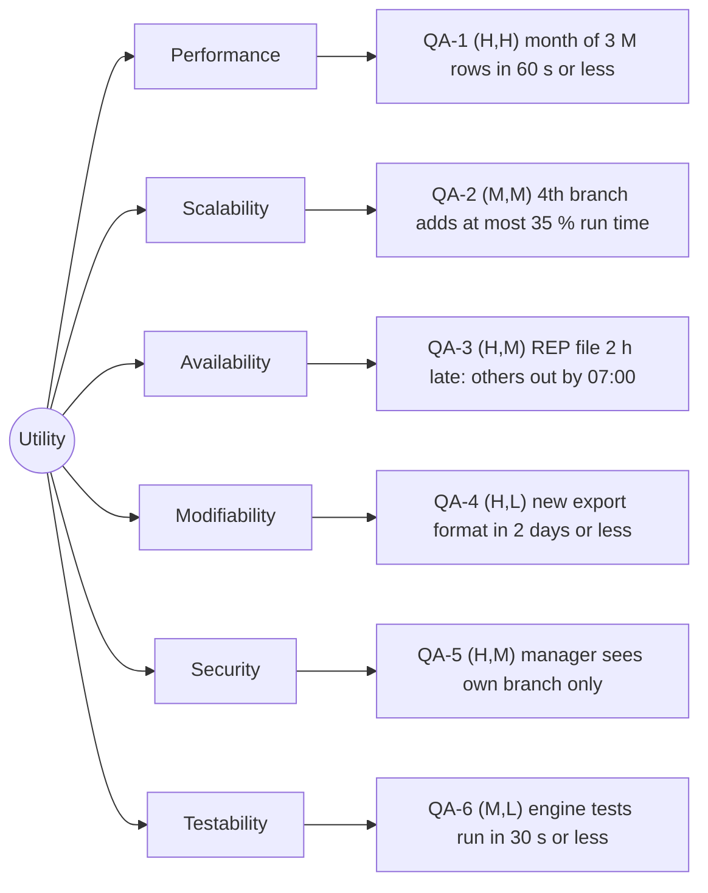
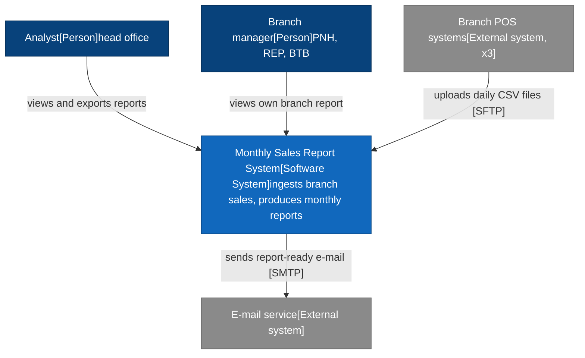
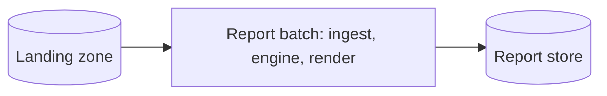

# Lab-01: Introduction to Software Engineering Concepts

**Software Engineering Concepts · Chapter 01**

> `Quality attributes · C4 · ADR` · `JDK 25 · Maven 3.9` · `JUnit 6.1.3` · `≈ 6 hours, in pairs` · `5 tasks + 1 challenge`

You start the Angkor Mart monthly sales report system the way an architect would: first the qualities it must have (measurable scenarios), then its context and containers (C4), then the first code: the sales-report Maven project with the canonical model package, a validated CSV parser, pluggable renderers (Strategy) and progress events (Observer). Two architecture decision records close the lab. The challenge compares three candidate architectures ATAM-style.

---

> [!NOTE]
> **How to work through this lab.** Work in pairs (or your project team) in one repository. Do the tasks in order; each builds on the previous. Read the *Goal*, follow the *Steps*, compare with the *Expected output*, and tick the *Acceptance checklist* (saved in your browser). Open a hint only when stuck for more than 10 minutes. Every member commits their own work: the grader reads the Git history, and a member without commits in `lab01/` or `src/` receives no points for the lab.

## Task 0 · Setup (`30 min`)

1. **Verify the tools.** JDK 25, Maven 3.9 and Git must be on the `PATH`:

```bash
java -version     # openjdk version "25..." (any JDK 25 build)
mvn -v            # Apache Maven 3.9.x, Java version: 25...
git --version
```

 For diagrams choose one: [Mermaid Live Editor](https://mermaid.live) (browser, exports PNG), the Mermaid preview in VS Code or IntelliJ, or PlantUML with its built-in C4 library (`java -jar plantuml.jar -tpng lab01/*.puml`). With Node.js installed, the Mermaid CLI also exports PNG: `npx -p @mermaid-js/mermaid-cli mmdc -i lab01/c4-context.mmd -o lab01/c4-context.png`.
2. **Create the team repository** `sales-report-<team>` on GitHub, add every member (Write access) and the instructor, clone it, and create the branch `lab-01`:

```bash
git clone https://github.com/<org>/sales-report-<team>.git
cd sales-report-<team>
git switch -c lab-01
mkdir -p lab01/adr tools
printf 'target/\ndata/\n' > .gitignore
```
3. **Read the case-study brief.** Everything this lab needs is here; later labs repeat what they need.

 Case-study brief: Angkor Mart monthly sales report
- **Company**: **Angkor Mart**, a fictional retail chain with three branches: `PNH` (Phnom Penh), `REP` (Siem Reap), `BTB` (Battambang). Head office (in Phnom Penh) needs a **monthly sales report** per branch and for the whole chain.
- **Input files**: Each branch's point-of-sale (POS) system exports one CSV file per day: `data/<yyyy-MM>/<BRANCH>-<yyyy-MM-dd>.csv`, UTF-8, header row, comma separated, no quoting (product names contain no commas).
 Header: `branch,date,receipt_no,sku,product_name,category,quantity,unit_price,discount,payment_method`
 Example: `PNH,2026-09-01,PNH-000123,SKU-1001,Jasmine Rice 5kg,Grocery,2,6.50,0.00,KHQR`
- **Values**: Categories: `Grocery`, `Beverages`, `Household`, `Personal Care`, `Electronics`, `Stationery`. Payment methods: `CASH`, `CARD`, `KHQR` (Cambodia's national QR payment standard). Currency USD. Quantity is a positive integer; a discount is never negative and never larger than the line total.
- **Money rule**: Line revenue = `quantity × unit_price − discount`, computed with `BigDecimal`, scale 2, `RoundingMode.HALF_UP`. Never `double` or `float` for money.
- **Report content**: Per branch and for the chain: total revenue, total discounts, number of receipts, average basket (revenue / receipts), revenue by category, top 10 products by revenue, revenue by payment method, month-over-month change, and anomalies (days more than 3 standard deviations from the branch's daily mean, and rows that fail validation). Output formats wanted: PDF and Excel for head office, a web page for branch managers.
- **Volumes, timing**: About 33 000 rows per branch per day, so about 3 million rows per month (3 × 30 × 33 000). Branch files for a day arrive by 23:00 over the branch's internet link; links fail now and then. Head office wants the report for month M on the morning of the 2nd day of month M+1. This lab uses a small sample (3 000 rows).
- **Users**: Head-office analysts view and export all reports; branch managers may see their own branch only; the finance director receives an e-mail when a report is ready. The instructor plays the client and answers questions about numbers you need.
- **Java names**: Maven `groupId` `edu.itc`, `artifactId` `sales-report`, root package `edu.itc.salesreport` with sub-packages `model`, `ingest`, `engine`, `render`, `ui` (later also `ipc`, `service`, `dsl`). Types: `record SaleTransaction(String branch, LocalDate date, String receiptNo, String sku, String productName, String category, int quantity, BigDecimal unitPrice, BigDecimal discount, PaymentMethod paymentMethod)` with `revenue()`; `enum PaymentMethod { CASH, CARD, KHQR }`; `record ProductTotal(String sku, String productName, BigDecimal revenue, long quantity)`; `record BranchSummary(String branch, BigDecimal revenue, BigDecimal discounts, long receipts, Map<String, BigDecimal> revenueByCategory, List<ProductTotal> topProducts, Map<PaymentMethod, BigDecimal> revenueByPayment)`; `record MonthlyReport(YearMonth month, List<BranchSummary> branches, BranchSummary chain, List<String> anomalies)`; interfaces `TransactionParser` (line → `SaleTransaction`, throws the checked `InvalidRowException`) and `ReportRenderer`. Keep these names identical: every later lab uses them.
- **Repository**: One team repository, one Maven project `sales-report` (Java 25) at its root until Lab-09; written deliverables of lab NN go in `labNN/`; each lab ends with "Record what changed" in `labNN/README.md`.
4. **Inputs.** Lab-01 is the first lab, so nothing comes from an earlier lab. If one of the items below is not available, use the fallback and carry on.

| Input | Where | What you need from it | Fallback if missing |
| --- | --- | --- | --- |
| Team repository | GitHub, step 2 | every member can push to `lab-01` | One member creates it in a personal account and transfers it to the organisation later; history is preserved. |
| JDK 25 and Maven 3.9 | your laptop or the lab machines | `java -version` shows 25 | Use the lab machines; do not lower the Java release in the POM. |
| Sample data | `tools/SampleData.java`, step 5 | 15 CSV files in `data/2026-09/` with two invalid rows | Create `data/2026-09/PNH-2026-09-01.csv` by hand: the header plus the example row of the brief, repeated with other SKUs, plus one row with quantity `two`. |
| Diagram tool | Mermaid or PlantUML | text source plus PNG export | Mermaid Live Editor in the browser needs no installation. |
| Client answers | instructor, or the brief | numbers for response measures | Use the brief and state every assumption explicitly in the scenario. |
5. **Generate the sample data.** Save this single-file program as `tools/SampleData.java` and run it from the repository root with `java tools/SampleData.java` (JDK 25 runs a source file directly; the unnamed class with an instance `main` is standard Java 25). The seed makes the data identical for every team.

```java
import java.io.IOException;
import java.nio.file.Files;
import java.nio.file.Path;
import java.time.LocalDate;
import java.time.YearMonth;
import java.util.ArrayList;
import java.util.List;
import java.util.Random;

/**
 * Lab-01 sample data: java tools/SampleData.java [month] [days] [rows] [seed]
 * Writes data/<month>/<BRANCH>-<date>.csv with two deliberately bad rows.
 */
void main(String[] args) throws IOException {
    var month = YearMonth.parse(args.length > 0 ? args[0] : "2026-09");
    int days = args.length > 1 ? Integer.parseInt(args[1]) : 5;
    int rowsPerDay = args.length > 2 ? Integer.parseInt(args[2]) : 200;
    var random = new Random(args.length > 3 ? Long.parseLong(args[3]) : 42);
    String[][] products = {
        {"SKU-1001", "Jasmine Rice 5kg", "Grocery", "6.50"},
        {"SKU-1002", "Fish Sauce 700ml", "Grocery", "1.80"},
        {"SKU-2001", "Mineral Water 1.5L", "Beverages", "0.45"},
        {"SKU-2002", "Iced Coffee Can", "Beverages", "0.90"},
        {"SKU-3001", "Dish Soap 500ml", "Household", "1.25"},
        {"SKU-3002", "Laundry Powder 1kg", "Household", "2.95"},
        {"SKU-4001", "Toothpaste 150g", "Personal Care", "1.60"},
        {"SKU-4002", "Shampoo 400ml", "Personal Care", "3.40"},
        {"SKU-5001", "USB-C Cable 1m", "Electronics", "4.50"},
        {"SKU-5002", "Power Bank 10000mAh", "Electronics", "18.00"},
        {"SKU-6001", "Notebook A5", "Stationery", "0.75"},
        {"SKU-6002", "Ballpoint Pen Blue", "Stationery", "0.30"}};
    String[] payments = {"CASH", "CARD", "KHQR", "KHQR"};
    Path dir = Files.createDirectories(Path.of("data", month.toString()));
    for (String branch : List.of("PNH", "REP", "BTB")) {
        int receipt = 0;
        for (int d = 1; d <= days; d++) {
            LocalDate date = month.atDay(d);
            var lines = new ArrayList<String>();
            lines.add("branch,date,receipt_no,sku,product_name,category,"
                    + "quantity,unit_price,discount,payment_method");
            String payment = "CASH";
            for (int r = 0; r < rowsPerDay; r++) {
                // a new receipt roughly every third line
                if (r == 0 || random.nextInt(3) == 0) {
                    receipt++;
                    payment = payments[random.nextInt(payments.length)];
                }
                String[] p = products[random.nextInt(products.length)];
                int qty = 1 + random.nextInt(4);
                String discount = random.nextInt(10) == 0 ? "0.10" : "0.00";
                lines.add(String.join(",", branch, date.toString(),
                        "%s-%06d".formatted(branch, receipt), p[0], p[1], p[2],
                        String.valueOf(qty), p[3], discount, payment));
            }
            if (branch.equals("REP") && d == 2) {
                lines.set(10, lines.get(10).replaceFirst(",\\d,", ",two,"));
            }
            if (branch.equals("BTB") && d == 4) {
                lines.set(20, lines.get(20).replaceAll(
                        "(CASH|CARD|KHQR)$", "PAYPAL"));
            }
            Files.write(dir.resolve(branch + "-" + date + ".csv"), lines);
        }
    }
    System.out.println("Wrote " + 3 * days + " files, " + 3 * days * rowsPerDay
            + " rows, to " + dir);
}
```

```plaintext
$ java tools/SampleData.java
Wrote 15 files, 3000 rows, to data/2026-09        (data\2026-09 on Windows)
$ head -3 data/2026-09/PNH-2026-09-01.csv
branch,date,receipt_no,sku,product_name,category,quantity,unit_price,discount,payment_method
PNH,2026-09-01,PNH-000001,SKU-2002,Iced Coffee Can,Beverages,3,0.90,0.00,KHQR
PNH,2026-09-01,PNH-000002,SKU-3002,Laundry Powder 1kg,Household,3,2.95,0.00,KHQR
```
6. **Deliverables of this lab** (commit all of them on `lab-01`):

```plaintext
lab01/
├── quality-scenarios.md                      Task 1
├── c4-context.mmd   + c4-context.png         Task 2 (or .puml)
├── c4-container.mmd + c4-container.png       Task 2
├── design-review.md                          Task 4
├── adr/0001-architecture-style-release-1.md  Task 5
├── adr/0002-branch-to-head-office-data-flow.md  Task 5
├── README.md                                 Task 5, record what changed
└── atam.md                                   Challenge
pom.xml, src/main/java/..., src/test/java/..., tools/SampleData.java   Tasks 3-4
```

## Task 1 · Quality-attribute scenarios and a utility tree (`Easy` · `45 min`)

### Goal

Turn the client's vague wishes ("fast", "reliable", "secure") into six testable quality-attribute scenarios for the report system, rank them, and identify the architectural drivers that the rest of the semester must satisfy.

### Steps

1. Create `lab01/quality-scenarios.md` from the starter. List the stakeholders in a short first section (at least: head-office analyst, branch manager, finance director, operations person who runs the job, your team as developers).
2. Write one scenario for each attribute, with ids `QA-1` performance, `QA-2` scalability, `QA-3` availability, `QA-4` modifiability, `QA-5` security, `QA-6` testability. Fill all six parts: source, stimulus, artifact, environment, response, response measure.
3. Every response measure is a number with a unit and a way to measure it: seconds of wall-clock time over 5 runs after 2 warm-up runs, percent of requests, number of files, person-days of effort, lines changed. "Fast" or "easy" earns no points.
4. Tie the numbers to the brief: QA-1 uses the real month volume (about 3 M rows); QA-3 uses a branch link failure; QA-5 uses "branch managers see their own branch only". Write every assumption you make in an *Assumptions* list below the table.
5. Rank each scenario with (importance to the business, difficulty for the architecture), each H, M or L, and justify each rank in one sentence.
6. Draw the utility tree as a Mermaid `flowchart LR` at the end of the file (root, six attributes, six leaves with id and rank) and name the **architectural drivers**: the (H,H) and (H,M) leaves.
7. Commit with a message such as `lab01: quality-attribute scenarios`; the author of each scenario is visible in `git log -p lab01/quality-scenarios.md`.

### Starter (lab01/quality-scenarios.md)

```markdown
# Quality-attribute scenarios: Angkor Mart monthly sales report

## Stakeholders
- Head-office analyst: ...
- Branch manager (PNH, REP, BTB): ...

## Scenarios
| ID | Attribute | Source | Stimulus | Artifact | Environment | Response | Response measure | Rank |
|----|-----------|--------|----------|----------|-------------|----------|------------------|------|
| QA-1 | Performance | Scheduler, 06:00 on day 2 of M+1 | Starts the report for a month of about 3 M rows | Report engine | Normal operation, 8-core server, files complete | Report files written, "ready" event published | <= 60 s wall-clock, median of 5 runs after 2 warm-up runs | (H,H) |
| QA-2 | Scalability | | | | | | | |
| QA-3 | Availability | | | | | | | |
| QA-4 | Modifiability | | | | | | | |
| QA-5 | Security | | | | | | | |
| QA-6 | Testability | | | | | | | |

## Rank justifications
- QA-1 (H,H): the report is due in the morning; 3 M rows with BigDecimal ...

## Assumptions
- A1: the report server has 8 cores and an SSD (to confirm with the client).

## Utility tree


## Architectural drivers
QA-?, QA-?, QA-?
```

### Expected output

The utility tree renders on GitHub (Mermaid is supported in Markdown) and looks like this, with your own wording and numbers:



<details>
<summary>💡 <strong>Show hints</strong></summary>

- Read each scenario aloud as one sentence: "When source does stimulus to artifact during environment, the system response within measure." If the sentence has no number, it is not finished.
- Modifiability scenarios have a developer as source and a change request as stimulus; the measure is effort (person-days) or the number of files touched.
- Testability: source is a developer or the CI server; the measure can be suite duration, coverage of engine, or "no file system or UI needed".
- Importance comes from the client (the brief, the instructor); difficulty comes from you: how much structure does it force? Parallelism for 3 M rows is hard; a new renderer behind an interface is easy.

</details>

### Acceptance checklist

- [ ] Six scenarios QA-1 to QA-6, one per attribute, all six parts filled.
- [ ] Every response measure is a number with a unit and a stated measurement method.
- [ ] Each scenario is ranked (importance, difficulty) with a one-sentence justification; assumptions are listed.
- [ ] The utility tree renders on GitHub and the architectural drivers are named.

## Task 2 · C4 context and container diagrams (`Easy` · `60 min`)

### Goal

Document the report system at C4 levels 1 and 2: who uses it and which external systems it talks to, then which containers (separately runnable or deployable units and data stores) release 1 consists of. Both diagrams are text sources in Git plus exported PNG files.

### Steps

1. List the people and external systems from the brief: at least the analyst, the branch manager, the branch POS systems and an e-mail service. Decide whether the finance director is a separate person box or covered by e-mail.
2. Write `lab01/c4-context.mmd` (Mermaid, starter below) or `lab01/c4-context.puml` (PlantUML with `!include <C4/C4_Context>`). Every box has a name, a type in brackets and one line of responsibility; every arrow has a verb phrase.
3. Write `lab01/c4-container.mmd` (or `.puml`) for release 1: draw the system boundary and put inside it at least an ingest job, a landing zone for the CSV files, a report batch (engine and renderers), a report store and the two user interfaces planned for Chapters 02, 03 and 08 (JavaFX desktop viewer, web report page). Give each container its technology in brackets.
4. From level 2 on, every arrow also names the protocol or mechanism: `[SFTP]`, `[file system]`, `[HTTPS]`, `[SMTP]`, `[in-process call]`.
5. Export both diagrams as PNG next to their sources (`lab01/c4-context.png`, `lab01/c4-container.png`) and check that they are readable at 100 % zoom.
6. Below each diagram, in `lab01/README.md` or a short `lab01/c4-notes.md`, add three sentences: what the diagram deliberately does not show, which quality-attribute scenario each of two containers serves (use the QA ids from Task 1), and one open question for the client.

### Starter (lab01/c4-context.mmd)

```plaintext
flowchart TB
  analyst["Analyst<br/>[Person]<br/>head office"]:::person
  manager["Branch manager<br/>[Person]<br/>PNH, REP, BTB"]:::person
  sys["Monthly Sales Report System<br/>[Software System]<br/>ingests branch sales, produces monthly reports"]:::system
  pos["Branch POS systems<br/>[External system, x3]"]:::external
  mail["E-mail service<br/>[External system]"]:::external

  analyst -- "views and exports reports" --> sys
  manager -- "views own branch report" --> sys
  pos -- "uploads daily CSV files [SFTP]" --> sys
  sys -- "sends report-ready e-mail [SMTP]" --> mail

  classDef person fill:#08427b,color:#ffffff,stroke:#052e56
  classDef system fill:#1168bd,color:#ffffff,stroke:#0b4884
  classDef external fill:#8a8a8a,color:#ffffff,stroke:#6b6b6b

%% Container diagram: copy this file to c4-container.mmd and replace sys with
%% subgraph boundary["Monthly Sales Report System"] ... end holding the containers.
```

### Expected output

The context starter renders like this; your container diagram adds a boundary with six or more containers inside it:



<details>
<summary>💡 <strong>Show hints</strong></summary>

- A container is not a Java package. model and ingest are components inside a container; the ingest job that runs every night is a container.
- In Mermaid, a boundary is a subgraph boundary["Monthly Sales Report System"] ... end; add style boundary stroke-dasharray: 5 5 for the dashed C4 look.
- PlantUML alternative: !include <C4/C4_Container>, then System_Boundary(s, "Monthly Sales Report System") { Container(batch, "Report batch", "Java 25", "Computes and renders the report") } and Rel(batch, store, "writes", "file system").
- Two containers can live in one Maven project: the ingest job and the report batch may be two main classes of sales-report that run at different times.

</details>

### Acceptance checklist

- [ ] Context diagram: the system, at least two people and two external systems, every arrow labelled.
- [ ] Container diagram: a system boundary with at least six containers, each with a technology in brackets.
- [ ] Level-2 arrows name a protocol or mechanism; no classes or packages appear in either diagram.
- [ ] Text sources and PNG exports are committed; the notes link two containers to QA ids.

## Task 3 · Bootstrap the `sales-report` project: model and CSV parser (`Medium` · `75 min`)

### Goal

Create the Maven project every later lab builds on: Java 25, JUnit 6, the canonical `model` records with their invariants, and a `CsvTransactionParser` that turns a valid line into a `SaleTransaction` and rejects every invalid line with a checked `InvalidRowException`.

### Steps

1. Add the `pom.xml` below at the repository root and create `src/main/java/edu/itc/salesreport/{model,ingest,render}` and `src/test/java/edu/itc/salesreport/{model,ingest,render}`. Run `mvn -q verify`: it must succeed (no tests yet).
2. In `model`, write `PaymentMethod` and the records `SaleTransaction`, `ProductTotal`, `BranchSummary`, `MonthlyReport` with exactly the components of the brief. The compact constructor of `SaleTransaction` rejects nulls, `quantity <= 0`, negative amounts and a discount larger than `quantity × unitPrice`.
3. Implement `SaleTransaction.revenue()` with `BigDecimal`, scale 2, `HALF_UP`. Add `BranchSummary.averageBasket()` (revenue / receipts, scale 2, `0.00` when there are no receipts). Make `BranchSummary` and `MonthlyReport` store unmodifiable copies (`List.copyOf`, `Map.copyOf`): information hiding.
4. In `ingest`, write the interface `TransactionParser`, the checked `InvalidRowException` and `CsvTransactionParser`. It splits on commas keeping empty fields (`split(",", -1)`), requires exactly 10 fields, checks the branch and category against the brief, converts each field, and turns every conversion or rule failure into an `InvalidRowException` whose message names the field.
5. Write `CsvTransactionParserTest`: one test for the example row of the brief (all fields and `revenue() == 13.00`), one with a discount, and a `@ParameterizedTest` with at least 8 invalid rows: empty line, 9 fields, unknown branch, impossible date `2026-09-31`, unknown category, non-numeric quantity, zero quantity, negative discount, discount above the line total, unknown payment method.
6. Write `SaleTransactionTest` with the rounding case `3 × 0.335 = 1.005 → 1.01` and a test proving that `BranchSummary.topProducts()` is unmodifiable.
7. Run `mvn test` and commit. Split the work: one member writes the model, the other the parser, and each writes the tests of the other's code.

### Starter code

```xml
<?xml version="1.0" encoding="UTF-8"?>
<project xmlns="http://maven.apache.org/POM/4.0.0"
         xmlns:xsi="http://www.w3.org/2001/XMLSchema-instance"
         xsi:schemaLocation="http://maven.apache.org/POM/4.0.0
           https://maven.apache.org/xsd/maven-4.0.0.xsd">
  <modelVersion>4.0.0</modelVersion>
  <groupId>edu.itc</groupId>
  <artifactId>sales-report</artifactId>
  <version>0.1.0-SNAPSHOT</version>
  <name>Angkor Mart monthly sales report</name>

  <properties>
    <maven.compiler.release>25</maven.compiler.release>
    <project.build.sourceEncoding>UTF-8</project.build.sourceEncoding>
  </properties>

  <dependencyManagement>
    <dependencies>
      <dependency>
        <groupId>org.junit</groupId>
        <artifactId>junit-bom</artifactId>
        <version>6.1.3</version>
        <type>pom</type>
        <scope>import</scope>
      </dependency>
    </dependencies>
  </dependencyManagement>

  <dependencies>
    <dependency>
      <groupId>org.junit.jupiter</groupId>
      <artifactId>junit-jupiter</artifactId>
      <scope>test</scope>
    </dependency>
  </dependencies>

  <build>
    <plugins>
      <plugin>
        <groupId>org.apache.maven.plugins</groupId>
        <artifactId>maven-compiler-plugin</artifactId>
        <version>3.16.0</version>
      </plugin>
      <plugin>
        <groupId>org.apache.maven.plugins</groupId>
        <artifactId>maven-surefire-plugin</artifactId>
        <version>3.6.0</version>
      </plugin>
      <plugin>
        <groupId>org.codehaus.mojo</groupId>
        <artifactId>exec-maven-plugin</artifactId>
        <version>3.6.4</version>
        <configuration>
          <mainClass>edu.itc.salesreport.App</mainClass>
        </configuration>
      </plugin>
    </plugins>
  </build>
</project>
```

```java
package edu.itc.salesreport.model;

import java.math.BigDecimal;
import java.math.RoundingMode;
import java.time.LocalDate;
import java.util.Objects;

/** One line of a branch receipt, exactly as exported by the POS. */
public record SaleTransaction(String branch, LocalDate date,
        String receiptNo, String sku, String productName,
        String category, int quantity, BigDecimal unitPrice,
        BigDecimal discount, PaymentMethod paymentMethod) {

    public SaleTransaction {
        Objects.requireNonNull(branch, "branch");
        // TODO: requireNonNull for the other reference components
        if (quantity <= 0) {
            throw new IllegalArgumentException("quantity must be > 0");
        }
        // TODO: reject negative unitPrice or discount
        // TODO: reject discount > quantity x unitPrice
    }

    /** quantity x unit price - discount, scale 2, HALF_UP. */
    public BigDecimal revenue() {
        // TODO: BigDecimal.valueOf(quantity), multiply, subtract,
        //       setScale(2, RoundingMode.HALF_UP)
        throw new UnsupportedOperationException("TODO");
    }
}
```

```java
package edu.itc.salesreport.ingest;

import edu.itc.salesreport.model.PaymentMethod;
import edu.itc.salesreport.model.SaleTransaction;

import java.math.BigDecimal;
import java.time.LocalDate;
import java.util.Set;
import java.util.function.Function;

/** Parses the canonical Angkor Mart POS export (10 fields, no quoting). */
public final class CsvTransactionParser implements TransactionParser {

    public static final String HEADER = "branch,date,receipt_no,sku,"
            + "product_name,category,quantity,unit_price,discount,"
            + "payment_method";

    private static final Set<String> BRANCHES = Set.of("PNH", "REP", "BTB");
    // TODO: CATEGORIES with the six categories of the brief

    @Override
    public SaleTransaction parse(String line) throws InvalidRowException {
        if (line == null || line.isBlank()) {
            throw new InvalidRowException("empty line");
        }
        String[] f = line.split(",", -1);
        if (f.length != 10) {
            throw new InvalidRowException(
                    "expected 10 fields but found " + f.length);
        }
        // TODO: check branch f[0] and category f[5]
        LocalDate date = field("date", f[1], LocalDate::parse);
        int quantity = field("quantity", f[6], Integer::parseInt);
        // TODO: unit_price, discount (BigDecimal::new),
        //       payment_method (PaymentMethod::valueOf)
        // TODO: new SaleTransaction(...); turn its IllegalArgumentException
        //       into an InvalidRowException
        throw new UnsupportedOperationException("TODO");
    }

    /** Converts one field; any RuntimeException becomes a checked error. */
    private static <T> T field(String name, String raw,
            Function<String, T> convert) throws InvalidRowException {
        try {
            return convert.apply(raw.strip());
        } catch (RuntimeException e) {
            throw new InvalidRowException(
                    "bad " + name + " '" + raw + "'", e);
        }
    }
}
```

```java
package edu.itc.salesreport.ingest;

import org.junit.jupiter.api.Test;
import org.junit.jupiter.params.ParameterizedTest;
import org.junit.jupiter.params.provider.ValueSource;

import java.math.BigDecimal;

import static org.junit.jupiter.api.Assertions.*;

class CsvTransactionParserTest {

    private final TransactionParser parser = new CsvTransactionParser();

    @Test
    void parsesAValidRow() throws InvalidRowException {
        var t = parser.parse("PNH,2026-09-01,PNH-000123,"
                + "SKU-1001,Jasmine Rice 5kg,Grocery,2,6.50,0.00,KHQR");
        assertEquals("PNH", t.branch());
        // TODO: date, productName, quantity, unitPrice, paymentMethod
        assertEquals(new BigDecimal("13.00"), t.revenue());
    }

    @ParameterizedTest
    @ValueSource(strings = {
        "",
        "PNH,2026-09-01,PNH-1,SKU-1,Rice,Grocery,2,6.50,0.00",
        "PNH,2026-09-31,PNH-1,SKU-1,Rice,Grocery,2,6.50,0.00,CASH"
        // TODO: at least 6 more invalid rows, one rule each
    })
    void rejectsInvalidRows(String line) {
        assertThrows(InvalidRowException.class, () -> parser.parse(line));
    }
}
```

### Expected output

```plaintext
$ mvn test
...
[INFO]  T E S T S
[INFO] Running edu.itc.salesreport.ingest.CsvTransactionParserTest
[INFO] Tests run: 13, Failures: 0, Errors: 0, Skipped: 0, Time elapsed: 0.130 s -- in edu.itc.salesreport.ingest.CsvTransactionParserTest
[INFO] Running edu.itc.salesreport.model.SaleTransactionTest
[INFO] Tests run: 3, Failures: 0, Errors: 0, Skipped: 0, Time elapsed: 0.005 s -- in edu.itc.salesreport.model.SaleTransactionTest
[INFO] Tests run: 16, Failures: 0, Errors: 0, Skipped: 0
[INFO] BUILD SUCCESS
```

Counts from the reference solution (10 invalid rows + 3 other parser tests, 3 model tests); yours may be higher, never lower than 12.

<details>
<summary>💡 <strong>Show hints</strong></summary>

- "a,b,".split(",") drops the trailing empty field and returns 2 elements; split(",", -1) keeps it and returns 3. The limit matters for rows with an empty last column.
- NumberFormatException is a subclass of IllegalArgumentException, and PaymentMethod.valueOf("PAYPAL") also throws IllegalArgumentException; LocalDate.parse throws DateTimeParseException. The field helper catches all of them as RuntimeException.
- Compare BigDecimal values in tests with new BigDecimal("13.00"): equals checks the scale too, so 13.0 is not equal to 13.00. That is intended here: it proves scale 2.
- Parsing "0" as a discount gives scale 0; the revenue still has scale 2 because of setScale at the end.

</details>

### Acceptance checklist

- [ ] `pom.xml` builds with Java 25 and JUnit 6.1.3; `mvn -q verify` passes from a clean clone.
- [ ] The five model types have exactly the canonical names and components; no `double` or `float` anywhere.
- [ ] The parser accepts the example row and rejects at least 8 kinds of invalid rows with an `InvalidRowException` naming the field.
- [ ] Rounding (`1.005 → 1.01`) and unmodifiable collections are tested; both members have commits in `src/`.

## Task 4 · Strategy for renderers, Observer for progress, and a design review (`Medium` · `90 min`)

### Goal

Apply two patterns where the quality-attribute scenarios ask for them: **Strategy** for output formats (modifiability, QA-4) with a sealed `ReportRenderer`, and **Observer** for load progress (the UI of Chapter 03 and the "ready" notification will subscribe). Then measure the coupling of your packages and write a short review.

### Steps

1. **Strategy.** Add the sealed interface `render.ReportRenderer` and `TextReportRenderer` from the starter. Implement `HtmlReportRenderer` (a `<table>` with one row per branch plus the chain: branch, revenue, receipts, average basket; escape `&`, `<`, `>`) and `CsvReportRenderer` (header `month,branch,revenue,discounts,receipts,average_basket`, one line per branch plus the chain). PDF and XLSX follow in Lab-08.
2. Write `ReportRendererTest` with the fixture `TestReports` (starter): a `@ParameterizedTest` over `txt`, `html`, `csv` checking that every branch code and the chain total `2300.50` appear; an exact CSV line (`2026-09,REP,800.50,0.00,50,16.01`); `forExtension("pdf")` throws; and an exhaustive `switch` over `ReportRenderer` without `default`.
3. **Observer.** Add `ingest.LoadEvent` and `ingest.LoadListener` from the starter, then complete `ingest.MonthLoader`: `subscribe` returns a `Runnable` that unsubscribes; `load(month, dataDir)` reads `data/yyyy-MM/*.csv` in name order, skips the header, parses each line, collects rejected lines as `"FILE:LINE message"`, publishes one `FileLoaded` per file and one `LoadFinished` at the end.
4. Add `ConsoleProgress` and the composition root `App` (starter), generate the sample data (Setup step 5) and run `mvn -q compile exec:java`. Compare with the expected output: 2 998 accepted rows, 2 rejected.
5. Write `MonthLoaderTest` with `@TempDir`: two small files (one with an invalid row) produce exactly 3 events in order, with correct accepted and rejected counts; a listener that unsubscribed before `load` receives nothing.
6. Add `DependencyRulesTest` (starter) so that the build fails if `model` imports another project package or `ingest` imports `render`. Run `mvn -q verify`.
7. Write `lab01/design-review.md` (at most one page): for each package its responsibility in one sentence (cohesion), its efferent (Ce) and afferent (Ca) couplings from the `import` lines, instability I = Ce / (Ca + Ce) with the arithmetic, one coupling you accept and why, and whether the sealed renderer hierarchy or an open interface better serves QA-4.

### Starter code

```java
package edu.itc.salesreport.render;

import edu.itc.salesreport.model.MonthlyReport;

/** Strategy: one way of turning a report into a file. */
public sealed interface ReportRenderer
        permits TextReportRenderer, HtmlReportRenderer, CsvReportRenderer {

    /** File extension without the dot, for example "html". */
    String extension();

    /** Bytes, because PDF and XLSX (Lab-08) are binary formats. */
    byte[] render(MonthlyReport report);

    /** Simple factory: picks the strategy for a file extension. */
    static ReportRenderer forExtension(String ext) {
        return switch (ext) {
            case "txt" -> new TextReportRenderer();
            case "html" -> new HtmlReportRenderer();
            case "csv" -> new CsvReportRenderer();
            default -> throw new IllegalArgumentException(
                    "no renderer for ." + ext);
        };
    }
}

// TextReportRenderer.java (complete; use it as the model for the others)
public final class TextReportRenderer implements ReportRenderer {

    @Override
    public String extension() {
        return "txt";
    }

    @Override
    public byte[] render(MonthlyReport report) {
        var sb = new StringBuilder();
        sb.append("Angkor Mart monthly sales ")
          .append(report.month()).append('\n');
        sb.append(String.format("%-6s %12s %9s %11s%n",
                "Branch", "Revenue", "Receipts", "Avg basket"));
        for (BranchSummary b : report.branches()) {
            line(sb, b);
        }
        line(sb, report.chain());
        return sb.toString().getBytes(StandardCharsets.UTF_8);
    }

    private static void line(StringBuilder sb, BranchSummary b) {
        sb.append(String.format("%-6s %12s %9d %11s%n", b.branch(),
                b.revenue(), b.receipts(), b.averageBasket()));
    }
}
```

```java
package edu.itc.salesreport.ingest;

import java.nio.file.Path;
import java.time.Duration;

/** What a MonthLoader tells its observers. */
public sealed interface LoadEvent {

    record FileLoaded(Path file, int accepted, int rejected,
            int filesDone, int filesTotal) implements LoadEvent { }

    record LoadFinished(int accepted, int rejected, Duration took)
            implements LoadEvent { }
}

// LoadListener.java
@FunctionalInterface
public interface LoadListener {
    void onEvent(LoadEvent event);
}

// MonthLoader.java: the subject
public final class MonthLoader {

    private final TransactionParser parser;
    private final List<LoadListener> listeners =
            new CopyOnWriteArrayList<>();
    private final List<String> rejectedRows = new ArrayList<>();

    public MonthLoader(TransactionParser parser) {
        this.parser = parser;
    }

    /** Registers a listener; the returned handle unsubscribes it. */
    public Runnable subscribe(LoadListener listener) {
        // TODO: add the listener, return () -> listeners.remove(listener)
        throw new UnsupportedOperationException("TODO");
    }

    public List<String> rejectedRows() {
        return List.copyOf(rejectedRows);
    }

    public List<SaleTransaction> load(YearMonth month, Path dataDir) {
        // TODO: list dataDir/month/*.csv sorted by name (Files.list)
        // TODO: for each file: read lines (UTF-8), skip index 0,
        //       parse, count rejected, record "FILE:LINE message",
        //       publish(new LoadEvent.FileLoaded(...))
        // TODO: publish(new LoadEvent.LoadFinished(...)) with the time taken
        throw new UnsupportedOperationException("TODO");
    }

    private void publish(LoadEvent event) {
        listeners.forEach(l -> l.onEvent(event));
    }
}
```

```java
// ConsoleProgress.java: an observer, exhaustive over the sealed event type
public final class ConsoleProgress implements LoadListener {
    @Override
    public void onEvent(LoadEvent event) {
        switch (event) {
            case LoadEvent.FileLoaded(var file, var ok, var bad,
                    var done, var total) ->
                System.out.printf("[%d/%d] %s  accepted %d  rejected %d%n",
                        done, total, file.getFileName(), ok, bad);
            case LoadEvent.LoadFinished(var ok, var bad, var took) ->
                System.out.printf("Loaded %d rows, rejected %d%n", ok, bad);
        }
    }
}

// App.java in edu.itc.salesreport: the composition root
public final class App {
    public static void main(String[] args) {
        var month = YearMonth.parse(args.length > 0 ? args[0] : "2026-09");
        var dataDir = Path.of(args.length > 1 ? args[1] : "data");
        var loader = new MonthLoader(new CsvTransactionParser());
        loader.subscribe(new ConsoleProgress());
        loader.load(month, dataDir);
        loader.rejectedRows()
              .forEach(r -> System.out.println("  rejected " + r));
    }
}
```

```java
// src/test/java/edu/itc/salesreport/render/TestReports.java
final class TestReports {

    private TestReports() { }

    static BranchSummary branch(String code, String revenue, long receipts) {
        var rev = new BigDecimal(revenue);
        return new BranchSummary(code, rev, new BigDecimal("0.00"),
                receipts, Map.of("Grocery", rev),
                List.of(new ProductTotal("SKU-1001", "Jasmine Rice 5kg",
                        rev, receipts)),
                Map.of(PaymentMethod.KHQR, rev));
    }

    static MonthlyReport september() {
        return new MonthlyReport(YearMonth.of(2026, 9),
                List.of(branch("PNH", "1200.00", 100),
                        branch("REP", "800.50", 50),
                        branch("BTB", "300.00", 40)),
                branch("ALL", "2300.50", 190),
                List.of());
    }
}

// src/test/java/edu/itc/salesreport/DependencyRulesTest.java
class DependencyRulesTest {

    private static final Path SRC =
            Path.of("src/main/java/edu/itc/salesreport");

    private static List<String> importsOf(String pkg) throws IOException {
        try (Stream<Path> files = Files.walk(SRC.resolve(pkg))) {
            return files.filter(p -> p.toString().endsWith(".java"))
                    .flatMap(DependencyRulesTest::lines)
                    .filter(l -> l.startsWith("import edu.itc.salesreport."))
                    .toList();
        }
    }

    private static Stream<String> lines(Path p) {
        try {
            return Files.readAllLines(p).stream().map(String::strip);
        } catch (IOException e) {
            throw new UncheckedIOException(e);
        }
    }

    @Test
    void modelImportsNoOtherProjectPackage() throws IOException {
        var offending = importsOf("model").stream()
                .filter(l -> !l.startsWith("import edu.itc.salesreport.model."))
                .toList();
        assertEquals(List.of(), offending);
    }

    @Test
    void ingestDoesNotKnowRendering() throws IOException {
        var offending = importsOf("ingest").stream()
                .filter(l -> l.contains(".render."))
                .toList();
        assertEquals(List.of(), offending);
    }
}
```

Imports are omitted in the combined snippets to keep them short; your IDE adds them. Each type goes in its own file.

### Expected output

```plaintext
$ mvn -q compile exec:java
[1/15] BTB-2026-09-01.csv  accepted 200  rejected 0
[2/15] BTB-2026-09-02.csv  accepted 200  rejected 0
[3/15] BTB-2026-09-03.csv  accepted 200  rejected 0
[4/15] BTB-2026-09-04.csv  accepted 199  rejected 1
[5/15] BTB-2026-09-05.csv  accepted 200  rejected 0
[6/15] PNH-2026-09-01.csv  accepted 200  rejected 0
[7/15] PNH-2026-09-02.csv  accepted 200  rejected 0
[8/15] PNH-2026-09-03.csv  accepted 200  rejected 0
[9/15] PNH-2026-09-04.csv  accepted 200  rejected 0
[10/15] PNH-2026-09-05.csv  accepted 200  rejected 0
[11/15] REP-2026-09-01.csv  accepted 200  rejected 0
[12/15] REP-2026-09-02.csv  accepted 199  rejected 1
[13/15] REP-2026-09-03.csv  accepted 200  rejected 0
[14/15] REP-2026-09-04.csv  accepted 200  rejected 0
[15/15] REP-2026-09-05.csv  accepted 200  rejected 0
Loaded 2998 rows, rejected 2
  rejected BTB-2026-09-04.csv:21 bad payment_method 'PAYPAL'
  rejected REP-2026-09-02.csv:11 bad quantity 'two'

$ mvn test
...
[INFO] Tests run: 2, Failures: 0, Errors: 0, Skipped: 0 -- in edu.itc.salesreport.DependencyRulesTest
[INFO] Tests run: 13, Failures: 0, Errors: 0, Skipped: 0 -- in edu.itc.salesreport.ingest.CsvTransactionParserTest
[INFO] Tests run: 2, Failures: 0, Errors: 0, Skipped: 0 -- in edu.itc.salesreport.ingest.MonthLoaderTest
[INFO] Tests run: 3, Failures: 0, Errors: 0, Skipped: 0 -- in edu.itc.salesreport.model.SaleTransactionTest
[INFO] Tests run: 7, Failures: 0, Errors: 0, Skipped: 0 -- in edu.itc.salesreport.render.ReportRendererTest
[INFO] Tests run: 27, Failures: 0, Errors: 0, Skipped: 0
[INFO] BUILD SUCCESS
```

Surefire also prints the elapsed time per class; it is left out here.

<details>
<summary>💡 <strong>Show hints</strong></summary>

- A sealed interface and its permitted classes must be in the same package (or module); the permitted classes must be final, sealed or non-sealed.
- Files.list(dir) returns a stream that holds an open directory handle: use it in try-with-resources, then .filter(p -> p.toString().endsWith(".csv")).sorted().toList().
- Line numbers for rejected rows are 1-based and include the header: list index n is line n + 1. That is why the bad REP row is reported as line 11.
- A method reference such as events::add is a perfectly good LoadListener in a test: no mocking library needed.
- For the review, count only imports of your own packages (edu.itc.salesreport.*); JDK imports do not count as coupling here.

</details>

### Acceptance checklist

- [ ] Three renderers behind the sealed `ReportRenderer`, chosen by `forExtension`; the renderer tests pass, including the exhaustive `switch`.
- [ ] `MonthLoader` publishes one event per file plus a final event; unsubscribe works; the console run matches 2 998 / 2.
- [ ] `DependencyRulesTest` passes and `mvn -q verify` prints nothing and exits with 0.
- [ ] `lab01/design-review.md` gives Ca, Ce and I with arithmetic for every package and argues sealed versus open for QA-4.

## Task 5 · Two architecture decision records, then record what changed (`Hard` · `60 min`)

### Goal

Record the two most expensive decisions of release 1 as ADRs, each argued from your Task 1 scenarios with real alternatives and honest negative consequences, and close the lab with `lab01/README.md`.

### Steps

1. Copy the ADR template into `lab01/adr/0001-architecture-style-release-1.md`. Decide the architectural style of release 1 (for example modular monolith batch, process pipeline, event-driven services). Evaluate at least **two alternatives** against your three architectural drivers, citing them by id (QA-1, QA-3, …).
2. Write `lab01/adr/0002-branch-to-head-office-data-flow.md`: how daily data travels from the three branches to head office. Consider at least: branches push one file per day (SFTP or HTTPS upload), head office pulls from each branch, and the POS publishes one event per receipt to a message broker.
3. In ADR-0002, state the failure policy for QA-3 explicitly: how long head office waits, whether a partial report is published, how a late file is merged later, and how a re-run stays idempotent (for example the file name `BRANCH-yyyy-MM-dd.csv` plus a SHA-256 checksum as the key; a re-upload replaces, never duplicates).
4. Every ADR has: title, status (`Proposed` or `Accepted`), date, deciders, context, decision, alternatives, consequences with at least two `+` and two `−` items, and a "Revisit when" trigger. Keep each ADR under one page.
5. Open the pull request early and ask the other member to review each ADR with at least one comment on GitHub; resolve it with a commit (the review is part of the grade).
6. **Record what changed.** Create `lab01/README.md` from the starter: a table of every file this lab produced with its purpose and author, the inputs reused (none for Lab-01: say so), and the first row of the change log. Commit, push, and tag the reviewed state: `git tag lab-01 && git push origin lab-01 --tags`.

### Starter (ADR template and README)

```markdown
# ADR-000N: <decision in a short imperative phrase>

Status: Proposed | Accepted | Superseded by ADR-000M
Date: 2026-09-.. · Deciders: <names>

## Context
Forces that make this decision necessary: scenarios by id (QA-1 ...),
constraints (team size, deadline, skills, infrastructure), facts from
the case-study brief. No solution yet.

## Decision
We will ... (one paragraph, active voice).

## Alternatives considered
- <Alternative A>: why it is attractive, why we did not choose it.
- <Alternative B>: ...

## Consequences
+ positive consequence, linked to a scenario id
+ ...
- negative consequence or new risk, linked to a scenario id
- ...

Revisit when: <observable trigger, e.g. "a month exceeds 10 M rows">
```

```markdown
# Lab-01: architecture foundations of the sales report system

Team: <name> · Members: <name (GitHub id)>, <name (GitHub id)>

## Files produced in this lab
| File | Purpose | Author(s) |
|------|---------|-----------|
| lab01/quality-scenarios.md | QA-1..QA-6, utility tree, drivers | ... |
| lab01/c4-context.mmd, .png | C4 level 1 | ... |
| lab01/c4-container.mmd, .png | C4 level 2, release 1 | ... |
| lab01/design-review.md | cohesion and coupling review | ... |
| lab01/adr/0001-architecture-style-release-1.md | ADR-0001 | ... |
| lab01/adr/0002-branch-to-head-office-data-flow.md | ADR-0002 | ... |
| pom.xml, src/**, tools/SampleData.java | sales-report 0.1.0-SNAPSHOT | ... |

## Inputs reused from earlier labs
None (first lab).

## Change log
| Date | Lab | Change | Commit or tag |
|------|-----|--------|---------------|
| 2026-10-.. | Lab-01 | Project created: model, parser, renderers, loader; 2 ADRs | lab-01 |
```

### Expected output

```plaintext
$ git log --oneline --stat -- lab01/adr | head -6
3f1c2ab lab01: ADR-0002 data flow, partial-report policy (review by Dara)
 lab01/adr/0002-branch-to-head-office-data-flow.md | 41 +++++++++++++
9a7e410 lab01: ADR-0001 modular monolith for release 1
 lab01/adr/0001-architecture-style-release-1.md    | 38 ++++++++++++

$ tree lab01
lab01
├── README.md
├── adr
│   ├── 0001-architecture-style-release-1.md
│   └── 0002-branch-to-head-office-data-flow.md
├── c4-container.mmd
├── c4-container.png
├── c4-context.mmd
├── c4-context.png
├── design-review.md
└── quality-scenarios.md
```

Hashes, names and line counts are illustrative; what matters is one commit per decision and a visible review.

<details>
<summary>💡 <strong>Show hints</strong></summary>

- The context section must make a reader who was not in the room understand why a decision was needed at all; if it already contains the solution, move that to "Decision".
- A good alternative is one you could defend. "Write it in assembler" is not an alternative; "Maven modules from day one" is.
- For ADR-0002, think about what happens at 23:30 when BTB's link is down: who notices, who is told, what the analyst sees at 08:00, and what happens when the file finally arrives at 10:00.
- It is fine for ADR-0001 to be superseded in Chapter 09: that is the point of recording "Revisit when".

</details>

### Acceptance checklist

- [ ] ADR-0001 and ADR-0002 follow the template, each with at least two alternatives and a "Revisit when" trigger.
- [ ] Both ADRs cite scenario ids and list at least two negative consequences each.
- [ ] ADR-0002 states the partial-failure and idempotent re-run policy for a late branch file.
- [ ] `lab01/README.md` lists every file with its author, says "no earlier inputs", has a change-log row, and the tag `lab-01` is pushed.

## Challenge: ATAM-style trade-off analysis of three candidate architectures (`Hard` · `90–120 min · optional, extra credit`)

### Scenario

Head office asks whether your ADR-0001 still holds when the chain opens more branches and wants the report earlier. Before the team commits to the direction of the next eight weeks, run a one-page ATAM-style evaluation of three candidates against your six scenarios: **A** modular monolith batch job (one JVM), **B** process pipeline (a coordinator and worker processes connected by pipes or local sockets), **C** event-driven microservices (ingest, aggregation, report and notification services connected by a message broker).

### Requirements

1. For each candidate, a small container sketch (Mermaid, in `lab01/atam.md`) with its containers and connectors.
2. A table: scenarios QA-1..QA-6 as rows, A/B/C as columns, each cell a rating (++, +, 0, −) and one sentence of reasoning; plus a "cost and skills" row.
3. A quantitative estimate of QA-1 for each candidate, with every assumption written down (per-row parse cost, serial fraction, IPC or broker throughput, serialization cost) and the arithmetic shown, including Amdahl's law for the parallel part.
4. At least three sensitivity points and two trade-off points, each naming the parameter, the attribute(s) it affects and the direction.
5. At least two risks and two non-risks, grouped into one or two risk themes linked to a business driver from the brief.
6. A recommendation that either confirms ADR-0001 or drafts ADR-0003 superseding it; the recommendation must follow from the table, not contradict it.

### Skeleton (lab01/atam.md)

```markdown
# ATAM-style evaluation: release 1 architecture

## Business drivers
- Report for month M on the morning of day 2 of M+1 (brief).
- ...

## Candidates
### A: modular monolith batch

### B: process pipeline
### C: event-driven microservices

## Scenario analysis
| Scenario | A | B | C |
|----------|---|---|---|
| QA-1 ... | ++ because ... | | |

## QA-1 estimates (assumptions first)

## Sensitivity points
- S1: <parameter> affects <attribute> in candidates <..>: ...

## Trade-off points
## Risks, non-risks, risk themes
## Recommendation
```

### Expected output (excerpt, with example assumptions)

```plaintext
QA-1 estimates. Assumptions: 3.0 M rows; parse 5 us/row on one core (15 s);
aggregation merge 2 s and rendering 1 s are serial; 8 cores.
  A  one JVM, 8 parser threads:   15 / 8 + 2 + 1          = 4.9 s   (meets 60 s)
  B  4 worker JVMs, send partial totals (few KB); JVM start 0.5 s in parallel:
                                  0.5 + 15 / 4 + 2 + 1    = 7.3 s   (meets)
  C  1 row per event, broker 50 000 msg/s: 3.0 M / 50 000  = 60 s broker time
                                  alone -> fails QA-1
     1 000 rows per event: 3 000 msgs / 50 000 = 0.06 s   -> about 5 s (meets)

Sensitivity point S3: event batch size in C affects QA-1 by three orders of
magnitude (60 s vs 0.06 s of broker time).
Trade-off point T1: a broker between ingest and aggregation buffers late files
(+QA-3) but adds a network hop, serialization and an operated component
(-QA-1, -cost, -QA-5 attack surface).
```

<details>
<summary>💡 <strong>Show hints</strong></summary>

- Amdahl's law: S(N) = 1 / ((1 − p) + p / N). With p = 15 / 18 ≈ 0.83 and N = 8, S ≈ 1 / (0.17 + 0.104) ≈ 3.7, which matches 18 s / 4.9 s.
- A sensitivity point is a single knob (thread count, batch size, format); a trade-off point is a knob that helps one attribute and hurts another. The same knob can be both if it affects several attributes.
- Non-risks are valuable: they tell the client what you have checked and need not worry about (for example, BigDecimal totals compared with a sequential baseline).
- Do not rate what you cannot explain: every ++ or − needs a mechanism ("no serialization", "one perimeter", "more endpoints").

</details>

### Acceptance checklist

- [ ] Three candidates sketched; a 6-scenario table with a reason in every cell and a cost row.
- [ ] QA-1 estimated for A, B and C with explicit assumptions and the arithmetic, including Amdahl's law.
- [ ] At least three sensitivity points, two trade-off points, two risks and two non-risks, grouped into risk themes.
- [ ] The recommendation follows from the analysis and confirms ADR-0001 or drafts a superseding ADR-0003.

## Grading rubric

| Component | Points | Full marks when… |
| --- | --- | --- |
| Task 1 · Quality-attribute scenarios | 15 | Six complete scenarios with measurable, method-backed response measures; justified ranks; a utility tree naming the drivers. |
| Task 2 · C4 diagrams | 15 | Context and container diagrams at the right level, labelled arrows with protocols, sources and PNGs committed, notes linking containers to QA ids. |
| Task 3 · Project, model, parser | 25 | Canonical names and components, invariants in the compact constructor, `BigDecimal` money, at least 8 invalid-row cases, all tests green. |
| Task 4 · Strategy, Observer, review | 20 | Sealed renderer hierarchy with three strategies and tests; observable `MonthLoader` with unsubscribe; dependency rules test; review with Ca, Ce, I arithmetic. |
| Task 5 · ADRs and README | 15 | Two argued ADRs with alternatives, negative consequences, failure policy and a visible peer review; complete `lab01/README.md` and tag. |
| Code, diagram and history quality | 10 | Readable code and diagrams; small commits with clear messages; both members visible in `git log`. |
| ★ Challenge (extra credit) | +20 | Complete ATAM-style analysis: sketches, reasoned table, QA-1 arithmetic, sensitivity and trade-off points, risk themes, consistent recommendation. |
| Total | 100 (+20) |  |

> [!NOTE]
> **Automatic deductions:** −10 if any money value is a `double` or `float` · −10 if `mvn -q verify` fails on a clean clone of branch `lab-01` · −5 per quality-attribute scenario without a measurable response measure · −5 if `model` imports another project package, or `DependencyRulesTest` is removed or disabled · −5 per ADR without real alternatives or without a negative consequence · −5 if a C4 diagram mixes levels (classes or packages in a context or container diagram) · −5 if a canonical type, package or component name differs from the case-study brief.

## Submission

1. Repository layout at the end of Lab-01:

```plaintext
sales-report-<team>/
├── .gitignore                      target/ and data/
├── pom.xml
├── tools/SampleData.java
├── src/main/java/edu/itc/salesreport/
│   ├── App.java
│   ├── model/    PaymentMethod, SaleTransaction, ProductTotal, BranchSummary, MonthlyReport
│   ├── ingest/   TransactionParser, InvalidRowException, CsvTransactionParser,
│   │             LoadEvent, LoadListener, MonthLoader, ConsoleProgress
│   └── render/   ReportRenderer, TextReportRenderer, HtmlReportRenderer, CsvReportRenderer
├── src/test/java/edu/itc/salesreport/
│   ├── DependencyRulesTest.java
│   ├── model/SaleTransactionTest.java
│   ├── ingest/CsvTransactionParserTest.java, MonthLoaderTest.java
│   └── render/ReportRendererTest.java, TestReports.java
└── lab01/    README.md, quality-scenarios.md, c4-*.mmd/.png, design-review.md,
              adr/0001-*.md, adr/0002-*.md, atam.md (challenge)
```
2. Self-check from a clean clone: `git clone … && cd sales-report-<team> && git switch lab-01 && mvn -q verify` prints nothing and exits with code 0; `java tools/SampleData.java && mvn -q compile exec:java` prints the progress lines of Task 4.
3. Work on branch `lab-01`, open a pull request titled `Lab-01 – <team name>` against `main`, request a review from the instructor, and push the tag `lab-01`. Do not merge before the review.

 Back to Chapter 01 slides Retake the chapter quiz
