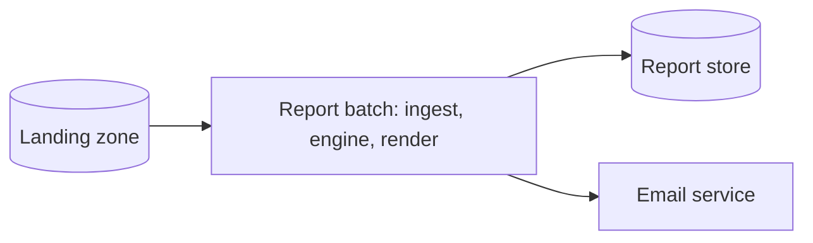
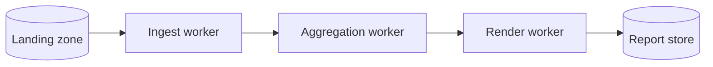
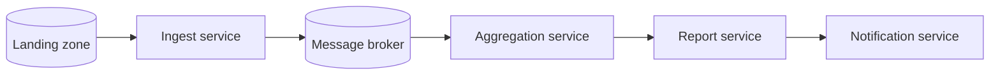

# ATAM-style evaluation: release 1 architecture

## Business drivers

- Publish the month M report on the morning of day 2 of M+1.
- Continue with a clearly marked partial report when a branch link fails.
- Protect branch data and keep new output formats inexpensive to add.

## Candidates

### A: modular monolith batch

### B: process pipeline

### C: event-driven microservices

## Scenario analysis

| Scenario | A | B | C |
|---|---|---|---|
| QA-1 performance | ++: no IPC or broker on the hot path | +: workers parallelize, but serialization adds overhead | 0: batching is required or broker traffic dominates |
| QA-2 scalability | +: thread and heap tuning are simple but share one JVM | ++: workers can scale independently by stage | ++: branch and aggregation services scale independently |
| QA-3 availability | +: rejected files and retries are local and explicit | +: a failed worker can be restarted, but coordination is needed | ++: durable events naturally buffer late branches |
| QA-4 modifiability | ++: interfaces and packages localize a renderer | +: contracts between processes must also change | 0: many service contracts and deployments increase change cost |
| QA-5 security | +: one perimeter and one audit path | 0: several process endpoints need protection | -: more endpoints, credentials, and broker policies |
| QA-6 testability | ++: fast in-process unit tests | +: component tests need process wiring | 0: broker and service integration tests are expensive |
| Cost and skills | ++: matches the current Java/Maven team | 0: requires process operations and IPC skills | -: requires broker, service, and distributed-operations skills |

## QA-1 estimates

Assumptions: 3.0 million rows; one-core parsing and validation costs 5
microseconds per row, so parsing costs 15 seconds; aggregation costs 2 seconds
and rendering costs 1 second; eight available cores.

- **A:** with eight parser threads, `15 / 8 + 2 + 1 = 4.875 s`.
  The parallel fraction is `p = 15 / 18 = 0.833`. Amdahl's law gives
  `S(8) = 1 / ((1 - 0.833) + 0.833 / 8) = 3.69`, consistent with the
  measured serial portion and well below 60 seconds.
- **B:** four workers and 0.5 seconds of parallel JVM startup:
  `0.5 + 15 / 4 + 2 + 1 = 7.25 s`, below 60 seconds.
- **C:** with one receipt per event and a broker limit of 50,000 messages per
  second, `3,000,000 / 50,000 = 60 s` before aggregation. With batches of
  1,000 rows, only 3,000 messages are sent and broker time is
  `3,000 / 50,000 = 0.06 s`; serialization and service work then make the
  estimate about 5 seconds. The candidate therefore depends critically on
  batching.

## Sensitivity points

- S1: parser thread count affects QA-1 and QA-2; increasing it improves
  throughput until memory bandwidth or contention dominates.
- S2: process payload size affects QA-1; larger batches reduce IPC overhead but
  increase recovery granularity.
- S3: event batch size affects QA-1 in C by three orders of magnitude
  (60 seconds versus 0.06 seconds of broker time).

## Trade-off points

- T1: a broker improves QA-3 buffering and replay, but adds serialization,
  operational cost, and a QA-5 attack surface.
- T2: more worker processes improve QA-2 isolation, but make QA-6 integration
  tests and deployment more complex.

## Risks and non-risks

**Availability and deadline risks:** a monolith can fail as one unit if file
isolation is not enforced; a broker can lose the deadline if events are sent
one receipt at a time. These risks are mitigated in release 1 by rejected-row
handling, file identity, and batch-sized work.

**Availability and correctness non-risks:** `BigDecimal` revenue calculations
are deterministic and are compared with a sequential test baseline. A
re-uploaded file is keyed by branch/date/checksum, so retries do not duplicate
transactions.

## Recommendation

Confirm ADR-0001 for release 1. Candidate A meets QA-1 with the lowest
operational and testing cost, while the package and interface boundaries leave
an extraction path if measured volume or availability requirements exceed the
monolith's limits.
