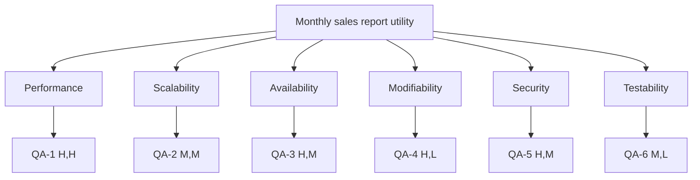

# Quality-attribute scenarios: Angkor Mart monthly sales report

## Stakeholders and architectural drivers

- **Head-office analyst:** needs complete, exportable monthly numbers.
- **Branch manager:** must see only the assigned branch.
- **Finance director:** needs a reliable report-ready notification.
- **Architectural drivers:** morning deadline, branch-link failures, and
  controlled access to branch data.

## Scenarios

| ID | Attribute | Source | Stimulus | Artifact | Environment | Response | Response measure | Rank |
|---|---|---|---|---|---|---|---|---|
| QA-1 | Performance | Scheduler at 06:00 on day 2 of M+1 | Starts a month of about 3 million rows | Report engine | 8-core server; all files complete | Writes reports and publishes a ready event | <= 60 seconds wall-clock, measured as the median of 5 runs after 2 warm-ups | (H,H) |
| QA-2 | Scalability | Operations | Adds a fourth branch and about 1 million rows/month | Ingest and report engine | Same 8-core server and 512 MB heap | Processes all four branches without OOM | Runtime grows by <= 35% and peak heap stays below 400 MB, median of 5 runs | (M,M) |
| QA-3 | Availability | Branch WAN | One branch is unreachable at the scheduled run | Ingest pipeline | Day 2 deadline and intermittent links | Retries, publishes a marked partial report, and merges the late file | Partial report is available by 07:00 with zero crashes; recovered data is merged within 5 minutes | (H,M) |
| QA-4 | Modifiability | Head-office analyst | Requests JSON output | ReportRenderer and render package | Standard developer workstation | Adds a renderer without changing calculations or existing renderers | <= 2 person-days and fewer than 50 changed lines outside the new renderer, measured by review | (H,L) |
| QA-5 | Security | Branch manager or attacker | Requests another branch's report | Web access-control boundary | Authenticated web session | Rejects the request, returns no data, and records the denial | 100% of cross-branch requests blocked and logged in a test matrix | (H,M) |
| QA-6 | Testability | Developer or CI | Runs the suite after a change | Model, ingest, render, and architecture tests | Workstation or CI without external services | Reports deterministic pass/fail results | Full suite completes within 30 seconds with 100% pass rate and no network/database dependency | (M,L) |

## Rank justifications

- **QA-1 (H,H):** missing the morning report affects finance decisions, and the
  three-million-row deadline forces careful parallelism and measurement.
- **QA-2 (M,M):** a fourth branch is plausible and adds 33% volume, but it is
  less urgent than the existing deadline.
- **QA-3 (H,M):** one link failure must not block head office; retries and
  partial-result handling are significant but bounded implementation work.
- **QA-4 (H,L):** new exports are a recurring business request and a strategy
  interface makes the change local.
- **QA-5 (H,M):** branch data is sensitive; role and branch filtering require
  careful authorization and audit behavior.
- **QA-6 (M,L):** fast deterministic tests reduce regression risk and support
  every later lab.

## Utility tree

