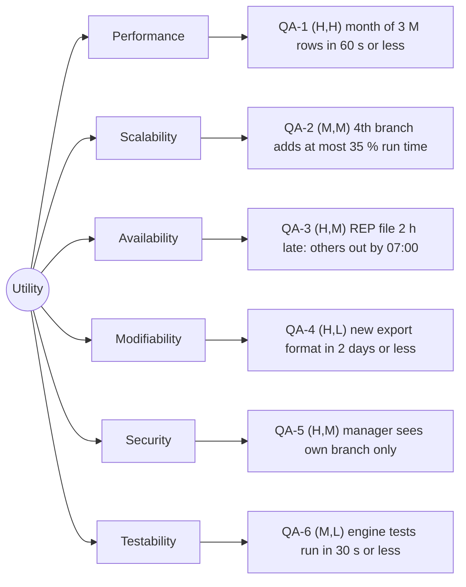

# Quality-attribute scenarios: Angkor Mart monthly sales report

## Stakeholders

- Head-office analyst: ...
- Branch manawger (PNH, REP, BTB): ...

## Scenarios

| ID   | Attribute     | Source                                                                                                          | Stimulus                                                                                                        | Artifact                                                                                                    | Environment                                                               | Response                                                                                                                                                                                                                                                                                                                                       | Response measure                                                                                                                                                 | Rank  |
| ---- | ------------- | --------------------------------------------------------------------------------------------------------------- | --------------------------------------------------------------------------------------------------------------- | ----------------------------------------------------------------------------------------------------------- | ------------------------------------------------------------------------- | ---------------------------------------------------------------------------------------------------------------------------------------------------------------------------------------------------------------------------------------------------------------------------------------------------------------------------------------------- | ---------------------------------------------------------------------------------------------------------------------------------------------------------------- | ----- |
| QA-1 | Performance   | Scheduler, 06:00 on day 2 of M+1                                                                                | Starts the report for a month of about 3 M rows                                                                 | Report engine                                                                                               | Normal operation, 8-core server, files complete                           | Report files written, "ready" event published                                                                                                                                                                                                                                                                                                  | <= 60 s wall-clock, median of 5 runs after 2 warm-up runs                                                                                                        | (H,H) |
| QA-2 | Scalability   | Operations / Business expansion                                                                                 | Onboarding a 4th branch (KPS), adding ~1 M rows/month (+33% data volume)                                        | Ingest pipeline & Report engine                                                                             | Normal batch run, unchanged 8-core server, standard heap (-Xmx512m)       | All 4 branches ingested and aggregated without OutOfMemoryError                                                                                                                                                                                                                                                                                | Runtime increases by <= 35% compared to 3-branch baseline; heap peaks < 400 MB (median of 5 runs after 2 warm-up runs)                                           | (M,M) |
| QA-3 | Availability  | Branch WAN / network link (e.g., REP branch internet connection drops)                                         | Network timeout / link down during monthly file retrieval (1 of 3 branches unreachable)                         | Ingestion pipeline / Report engine                                                                          | Scheduled batch run (06:00 on day 2 of M+1)                               | Pipeline retries with exponential backoff (3 attempts), logs warning alert, and generates a partial report for available branches with missing data clearly flaggedThe pipeline retries with backoff (e.g., 3 attempts), logs an error, generates a partial report with the available 2 branches marked clearly as degraded, and sends an aler | Report for available branches generated in <= 60 s (published by 07:00); 0 pipeline crashes; missing branch ingested and merged within <= 5 min of link recovery | (H,M) |
| QA-4 | Modifiability | Head-office analyst / Business stakeholder                                                                      | Requests a new output report format (e.g., JSON export) for head-office integration.                            | ReportRenderer interface and the render package                                                            | Development time / Maintenance phase on a standard developer workstation. | A developer implements a new renderer class conforming to the sealed`ReportRenderer` interface, updates the factory method in `ReportRenderer`, and adds unit tests without altering existing rendering or calculation code.                                                                                                                   | Completed in\$\\le 2\$ person-days of effort with fewer than 50 lines of new or modified code outside the new renderer class.                                    | (H,L) |
| QA-5 | Security      | An unauthorized user, an external attacker, or a branch manager attempting to view another branch's sales data. | An unauthorized user, an external attacker, or a branch manager attempting to view another branch's sales data. | Access control filter / Web UI authentication and authorization modul                                       | Normal operational state with active branch manager web sessions.         | The system rejects the request, restricts visibility strictly to the user's assigned branch, displays an access-denied message, and records 100% of the denial event with a timestamp and user ID in the audit log.                                                                                                                            | 100% of unauthorized cross-branch requests are blocked with zero data leakage, and 100% of denials are successfully logged.                                      | (H,M) |
| QA-6 | Testability   | Developer                                                                                                       | Run the automated test after code changes                                                                       | Test packages (src/test/java) covering model, ingest, renderers, and architecture dependency rules.Test uni | Standard developer workstation or GitHub Actions CI runner.               | The test runner executes all unit tests, validates dependency rules, and reports results accurately with zero flaky failures or external database/network dependencies.                                                                                                                                                                        | Total test suite execution time\$\\le 30\$ seconds with a 100% pass rate.                                                                                        | (M,L) |

## Rank justifications

- QA-1 (H,H): the report is due in the morning; 3 M rows with BigDecimal ...
- QA-2 (M,M): adding branches expands data volume linearly (+33%); a near-future expansion requiring streaming ingestion rather than buffering all rows in memory.
- QA-3 (H,M): (High importance to business because one broken link shouldn't block the whole report, Medium architectural difficulty using retry / circuit-breaker / fault isolation)
- QA-4 (H,L): Business reporting requirements frequently evolve, requiring new export formats for downstream systems or management workflows.The design uses the **Strategy pattern** with a sealed interface (ReportRenderer), isolating changes so that adding a new format requires no modification to existing engine or model code.
- QA-5 (H,M): Blocking unauthorized access is very important for the business for operationality and confidentiality reason. Requires robust role-based access control (RBAC), secure URL/session token validation, and comprehensive audit logging across all endpoints
- QA-6 (M,L):Fast and reliable test suites are crucial for maintaining developer velocity and catching regressions early.The modular design, pure domain models, and independent components (using JUnit 6) make the codebase inherently straightforward to test in complete isolation.

## Assumptions

- A1: the report server has 8 cores and an SSD (to confirm with the client).
- A2: daily branch CSV files are independent and can be parsed and aggregated concurrently or sequentially without cross-branch contention.

## Utility tree

## Architectural drivers

QA-1 (Performance), QA-3 (Availability), QA-5 (Security)

