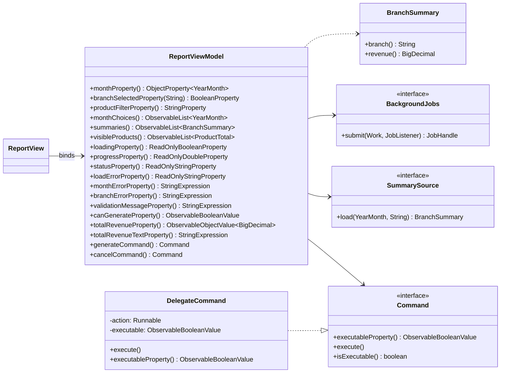
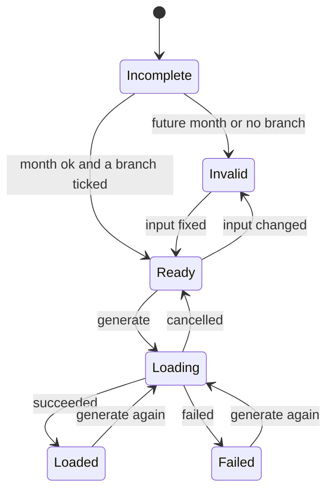

# Lab-03: ViewModel Design & Architecture

## 1. Lab-02 Controller Inventory

Refactoring the presentation logic from MVC (`ReportController`) into MVVM separates concerns cleanly between UI controls (View), presentation logic/state (ViewModel), and domain processing (Model).

| Code / Operation in Controller | Concern | New Owner |
| --- | --- | --- |
| `month.getValue()` | Reading selected month from UI combo box | ViewModel (`monthProperty()`, 2-way bound by View) |
| `if (m == null) status.setText("Choose a month.")` | Input validation for missing month | ViewModel (`monthError`, `validationMessage`) |
| `if (m.isAfter(now)) ...` | Validation rule: month cannot be in future | ViewModel (`checkMonth()`, injected `Clock`) |
| `for (CheckBox box : branches) box.isSelected()` | Reading active branch selections | ViewModel (`branchSelected(branch)`, 2-way bound by View) |
| `if (noBranchSelected) ...` | Validation rule: at least one branch required | ViewModel (`branchError`, `validationMessage`) |
| `generate.setDisable(loading || invalid)` | Button state / execution guard | ViewModel (`canGenerate`, `generateCommand()`) |
| `engine.summarizeBranch(m, branch, dataDir)` | Asynchronous data loading and summarization | Model via `SummarySource` executed via `BackgroundJobs` |
| `table.getItems().setAll(rows)` | Updating table items with loaded data | ViewModel (`summaries()`, 1-way bound by View) |
| `status.setText("Loaded " + rows.size() + ...)` | Status line display | ViewModel (`statusProperty()`, 1-way bound by View) |
| `catch (IOException e) status.setText(...)` | Error handling on load failure | ViewModel (`loadErrorProperty()`, `statusProperty()`) |
| `chainRevenue.setText(...)` | Aggregating and formatting total revenue | ViewModel (`totalRevenueProperty()`, `totalRevenueTextProperty()`) |
| `search.textProperty().addListener(...)` | Product filtering by name or SKU | ViewModel (`productFilterProperty()`, `visibleProducts()`) |

---

## 2. ViewModel Members and Access Rights

### Input State (View May Write via Two-Way Binding)
- `month`: `ObjectProperty<YearMonth>` — Currently selected report month.
- `branchSelected(String branch)`: `BooleanProperty` — Selection state for each branch (`PNH`, `REP`, `BTB`).
- `productFilter`: `StringProperty` — Search term for top products filter.

### Output State (View May Only Read via One-Way Binding)
- `monthChoices`: `ObservableList<YearMonth>` (unmodifiable) — Choices for the month dropdown (current month and past 11 months).
- `summaries`: `ObservableList<BranchSummary>` (unmodifiable) — Loaded branch report data rows.
- `products`: `ObservableList<ProductTotal>` — Raw merged top products from loaded branches.
- `visibleProducts`: `FilteredList<ProductTotal>` — Filtered top products list matching `productFilter`.
- `loading`: `ReadOnlyBooleanProperty` — True when background load task is executing.
- `progress`: `ReadOnlyDoubleProperty` — Load progress fraction between 0.0 and 1.0.
- `status`: `ReadOnlyStringProperty` — Status bar message text.
- `loadError`: `ReadOnlyStringProperty` — Error description if background load failed.

### Computed Properties (View May Only Read)
- `monthError`: `StringExpression` — Month validation error message.
- `branchError`: `StringExpression` — Branch selection validation error message.
- `validationMessage`: `StringExpression` — Combined validation message.
- `canGenerate`: `ObservableBooleanValue` — Boolean flag indicating whether generate command can execute.
- `totalRevenue`: `ObservableObjectValue<BigDecimal>` — Total sum of revenue across loaded branches.
- `totalRevenueText`: `StringExpression` — Formatted total revenue string (e.g. `USD 12,345.60`).

### Commands
- `generateCommand`: `Command` — Triggers background loading when `canGenerate` is true.
- `cancelCommand`: `Command` — Cancels running background task when `loading` is true.

### Ports (Dependencies)
- `SummarySource`: Functional interface abstracting branch summary loading from the model.
- `BackgroundJobs`: Abstraction for offloading work from the UI thread to background worker threads.
- `Clock`: Injected time source for deterministic date/time testing without reliance on system clock.

---

## 3. Mermaid Class Diagram

---

## 4. State Diagram (Task 3)

### Property Values per State
| State | `month` | `selectedBranches` | `loading` | `canGenerate` | `validationMessage` | `status` |
| --- | --- | --- | --- | --- | --- | --- |
| **Incomplete** | `null` | 1+ ticked | `false` | `false` | `"Choose a month."` | `"Choose a month."` |
| **Invalid** | future or valid | 0 ticked (or future) | `false` | `false` | `"Month ... is in the future."` or `"Select at least one branch."` | depends |
| **Ready** | valid past/present | 1+ ticked | `false` | `true` | `""` (empty) | `"Ready"` or previous status |
| **Loading** | valid | 1+ ticked | `true` | `false` | `""` | `"Loading..."` / progress fraction |
| **Loaded** | valid | 1+ ticked | `false` | `true` | `""` | `"Loaded N branch(es) for ..."` |
| **Failed** | valid | 1+ ticked | `false` | `true` | `""` | `"Load failed, previous data kept."` |
